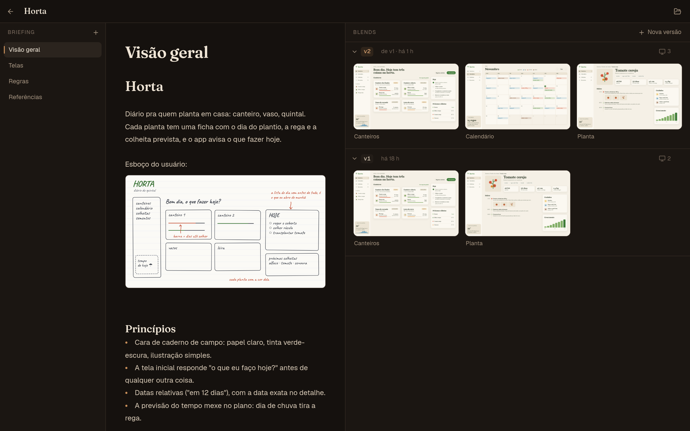
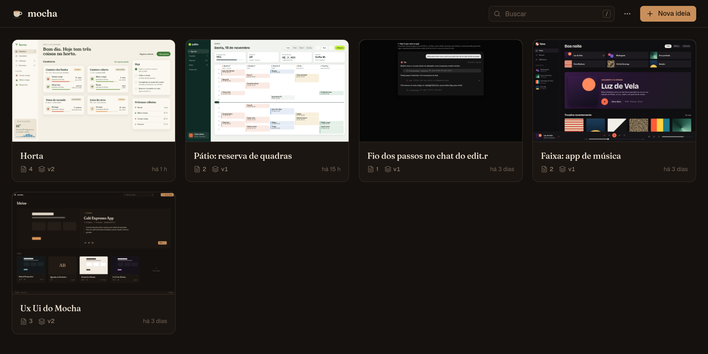
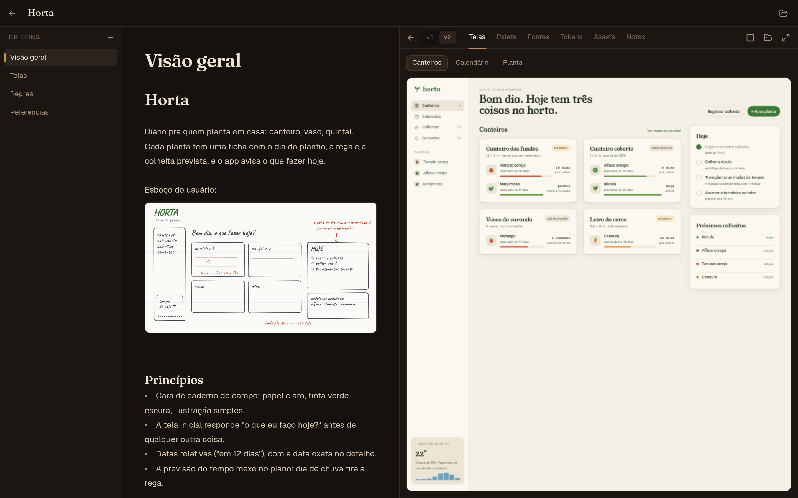
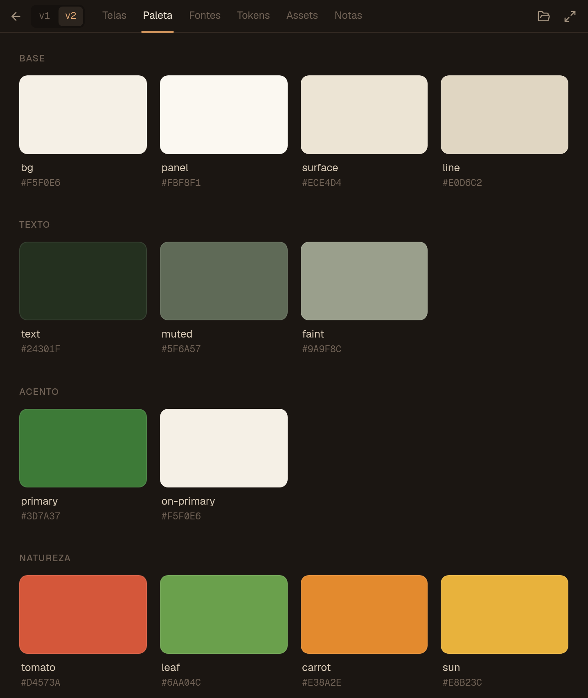
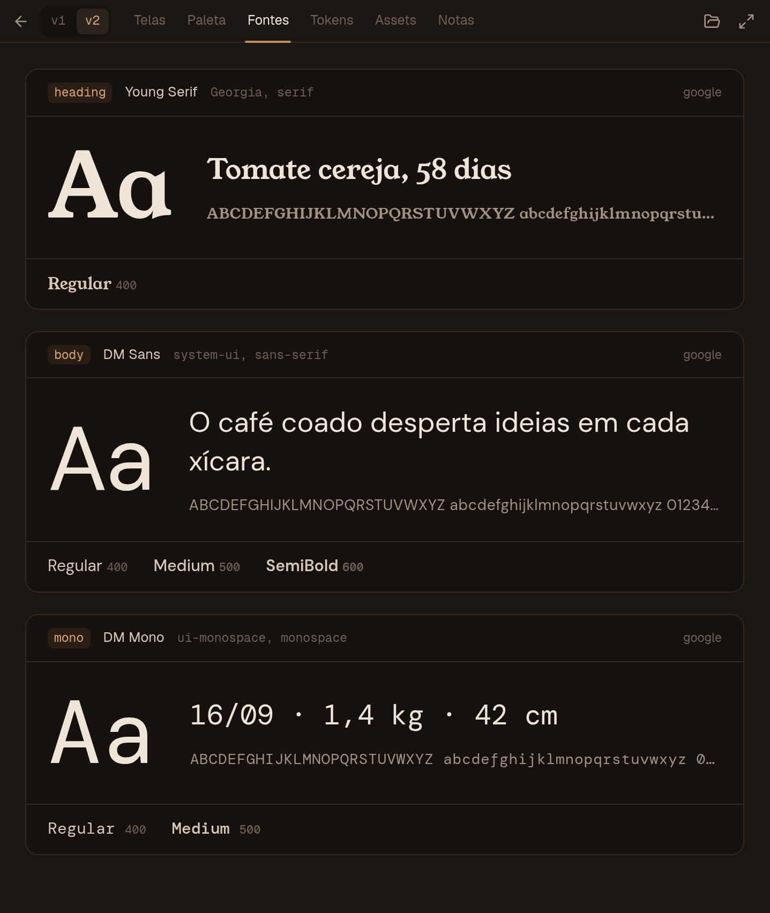

<div align="center">


# mocha

</div>

Organizador de design de aplicações web, por ideia. Roda na máquina, sem login, e tudo é arquivo de verdade numa pasta (o *vault*).



- **Ideia**: um projeto. Tem um briefing e os blends.
- **Briefing**: tópicos em markdown, estilo Obsidian, com imagens de referência coladas direto no editor.
- **Blend**: o design feito a partir do briefing, em HTML puro, versionado (`v1`, `v2`…). Cada versão tem telas, paleta, fontes, tokens, assets e notas.
- **MCP**: agentes leem o briefing, criam e editam blends e aplicam o design em outros projetos.

## Telas

**Ideias.** Cada ideia vira um cartão com a primeira tela do blend mais novo, quantos tópicos tem o briefing e a versão atual.



**Blend ao lado do briefing.** As telas da versão rodam ali mesmo e mudam na hora quando um agente ou um editor mexe no HTML.



**Paleta e fontes**, lidas do `tokens.json` da versão.

| Paleta | Fontes |
| --- | --- |
|  |  |

## Rodar

```bash
pnpm install
pnpm dev          # app Tauri
pnpm dev:web      # só a interface, no navegador, lendo o vault pelo servidor do Vite
pnpm build        # instalador
pnpm typecheck
```

`pnpm dev:web` usa o mesmo vault do app (`MOCHA_VAULT` troca a pasta).

## O vault

```
~/Mocha/
  ideias/<slug>/
    ideia.json                 nome, datas, ordem dos tópicos
    briefing/
      Visão geral.md           um arquivo por tópico; o título é o nome do arquivo
      assets/                  imagens coladas no editor
    blends/
      v1/
        index.html             uma tela por .html; o <title> vira o nome da tela
        tokens.json            colors, fonts, radii, spacing, shadows
        tokens.css             gerado do tokens.json (var(--color-*), var(--font-*)…)
        notas.md               o que mudou nesta versão
        blend.json             data e versão de origem
        assets/                svgs, imagens, fontes
  .lixeira/                    nada é apagado de vez; vem para cá
```

Pode editar tudo por fora (editor, agente, git): o app observa a pasta e atualiza na hora, inclusive os iframes das telas.

## MCP

O servidor fica em `packages/mcp` e vai junto no pacote do app. Para conectar:

```bash
pnpm mcp:build
claude mcp add mocha -s user -- node "$(pwd)/packages/mcp/dist/mocha-mcp.js"
```

No app, o menu `⋯` → **Conectar agente** mostra o comando com o caminho certo da instalação.

O vault que o MCP usa: `MOCHA_VAULT` > pasta escolhida no app > `~/Mocha`.

| Ferramenta | |
| --- | --- |
| `buscar_ideia` | acha a ideia pelo nome, título de tópico ou texto do briefing |
| `listar_ideias` | todas, da mais recente para a mais antiga |
| `ler_ideia` | briefing completo, versões e caminhos |
| `criar_ideia` | ideia nova |
| `escrever_topico` | cria ou substitui um tópico do briefing |
| `ler_blend` | telas (HTML), tokens, notas e arquivos de uma versão |
| `criar_blend` | próxima versão, copiando a mais nova (ou do zero) |
| `escrever_arquivo_blend` | tela, svg, css ou notas dentro de uma versão |
| `definir_tokens` | paleta, fontes, raios, espaços e sombras; regenera o `tokens.css` |

O parâmetro `ideia` aceita slug, nome ou um pedaço do nome: dá para mencionar a ideia no chat e o agente acha.

## Estrutura

```
apps/desktop          Tauri 2 + React 19 + Vite + Tailwind 4
  src-tauri/          disco preso ao vault, watcher, protocolo mocha:// dos iframes
  src/editor/         CodeMirror 6 com live preview
packages/core         formato do vault; usado pelo app e pelo MCP
packages/mcp          servidor MCP (stdio)
```

Cada versão de blend é servida numa origem própria (`mocha://v<n>.<slug em hex>/`), que só enxerga a pasta daquela versão. O iframe roda com `allow-scripts allow-same-origin` relativo a essa origem: carrega o próprio `tokens.css` e assets, mas o HTML que um agente escreve não lê o resto do vault nem alcança o app.
